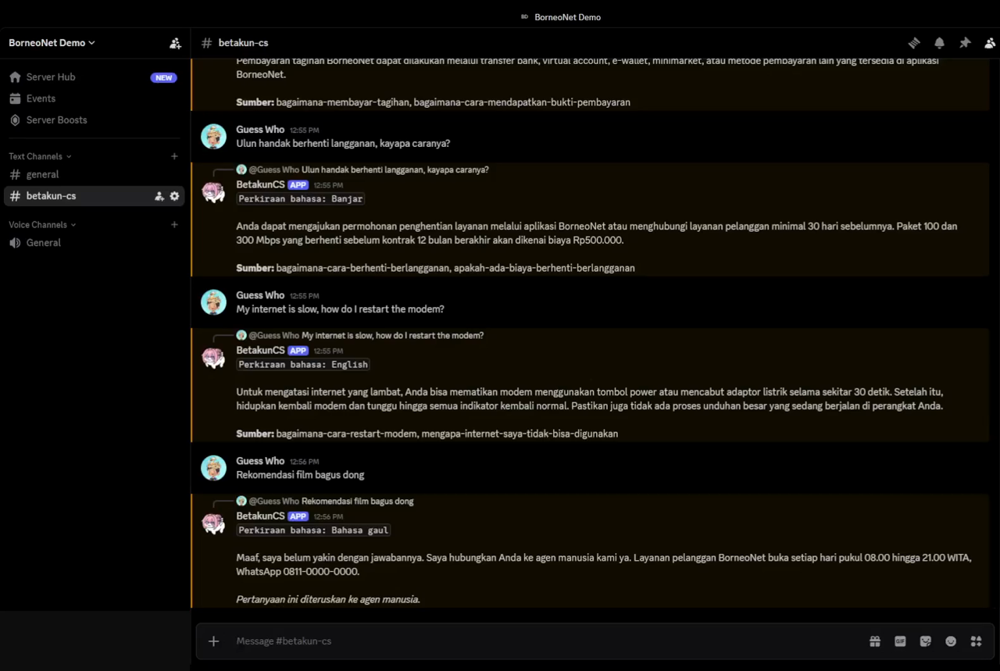
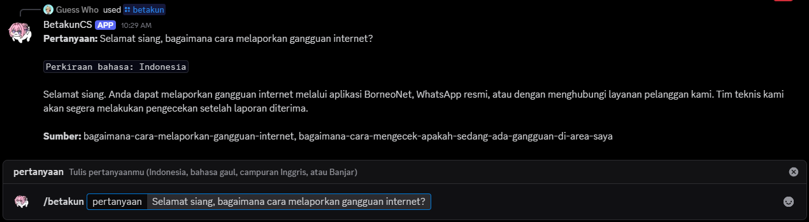

# Betakun CS

An Indonesian customer-support bot for **BorneoNet**, a fictional internet provider in South Kalimantan. It answers from a small FAQ, cites its sources, and hands the customer to a human when it is not sure.

The point of the project is the language mix real customers use: formal Indonesian, slang and abbreviations, typos, Indonesian-English code-mixing, and **Bahasa Banjar** (Banjarese) mixed with Indonesian. "Betakun" comes from the Banjarese word for "to ask".




Full recording (about 2 minutes, silent): [docs/demo.mp4](docs/demo.mp4)

> BorneoNet is made up. All prices, hours and the WhatsApp number (0811-0000-0000) are fictional and live in `data/facts.md`.

## What it does

- Understands five styles of question: formal, slang/abbreviations, typos, English mixed with Indonesian, and Banjarese mixed with Indonesian.
- Answers in clear Indonesian using only the FAQ text.
- Shows which FAQ entries it looked at ("Sumber") and a rough language badge.
- Hands off to a human (with the real opening hours and contact) when the FAQ cannot answer or the question has nothing to do with BorneoNet.
- Three ways to use it: Discord bot (type in the channel or use the `/betakun` command), Gradio web chat, and a FastAPI endpoint.

## How it works

```
question
  -> normalize slang and Banjarese words (data/normalization.csv, used for the search only)
  -> embed with intfloat/multilingual-e5-base
  -> find the 8 closest FAQ entries in ChromaDB
  -> if the closest one is too far away (distance > 0.45): hand off
  -> otherwise Gemini answers from those entries only
  -> if Gemini replies [HANDOFF]: hand off
  -> answer + sources
```

The model sees the customer's original wording. Normalization is applied only to the search query. One FAQ file is one search chunk (35 files in `data/faq/`).

## Results

I built a test set of 156 questions (`data/test_set.csv`): 28 each of formal, slang, typo, code-mixed and Banjarese, plus 16 out-of-scope questions (10 unrelated, 6 about BorneoNet topics the FAQ does not cover). Answers are graded by an LLM judge against a reference answer; I hand-checked a 20% sample and agreed with the judge on all 27.

| Step (one change at a time) | In-scope correct | Wrongly handed off | Out-of-scope handled |
|---|---|---|---|
| Baseline (retrieve 4, answer) | 86.4% | 3.6% | 56.2% |
| + `[HANDOFF]` marker from the model | 85.7% | 7.1% | 100% |
| + distance cutoff 0.45 | 87.9% | 5.0% | 100% |
| + retrieve 8 instead of 4 | 91.4% | 3.6% | 100% |
| + normalize slang/Banjarese for search | 92.9% | 1.4% | 100% |

Banjarese questions went from 82.1% to 85.7% correct over the same steps.

**Held-out check.** After tuning, I wrote 20 new questions that I had not used for any tuning (6 Banjarese with words not in my word list, plus slang, typos, code-mixing, formal and out-of-scope). Result: **75-80% correct (15-16 of 20 across two runs), 4 of 4 out-of-scope handled.** This is the honest number; the 92.9% above is on the set I tuned against.

**Temperature 0 made it worse.** I tried temperature 0 to remove noise. On the same questions it scored lower (main set 87.9%, held-out 65%), partly through a stricter judge and partly through more handoffs, so I left the default.

## Known limitations

- **The 92.9% is optimistic.** The normalization word list and the 0.45 cutoff were chosen after looking at the test set. Use the held-out number.
- **Noise.** Re-running the same questions changes the score by about 1 question on 20 and 2-3 on 140. Differences smaller than that are not real.
- **The judge is imperfect.** It sometimes marks a correct answer wrong when it is more specific than the reference.
- **Small held-out set.** 20 questions means one miss is 5 points. Two of the four held-out misses were arguably sensible cautious handoffs (the FAQ never mentions QRIS or what a red modem light means), but I did not relabel them after seeing the results.
- **Retrieval misses.** On fresh questions the right FAQ entry was in the top 8 for about 87% of answerable questions (14 of 16), against 99% on the tuned set.
- **Sources are not exact.** The "Sumber" line shows the top 2 retrieved entries, not necessarily the ones the answer used.
- **The language badge is a rough guess** from word lists and can be wrong.
- **Small FAQ.** 35 entries. Anything outside them is handed off, by design.
- **Not hosted.** Hugging Face now charges for Gradio Spaces on new free accounts, and I kept the project free. The Discord bot runs only while the program runs on my computer; it is not online 24/7.

## Run it yourself

You need Python and a free Gemini API key from Google AI Studio. Everything here is free.

```
git clone https://github.com/saidrahadi98-sudo/betakun-cs.git
cd betakun-cs
python -m venv .venv
.venv\Scripts\activate          # Windows PowerShell
pip install -r requirements.txt
```

Create a file named `.env` in the project folder (never commit it):

```
GEMINI_API_KEY=your_key_here
LLM_MODEL=gemini-3.5-flash-lite
DISCORD_TOKEN=only_needed_for_the_discord_bot
```

Build the search database once (the first run downloads the embedding model, about 1 GB):

```
python -m src.ingest
```

Then pick one:

```
python app.py                        # web chat (Gradio), opens on http://127.0.0.1:7860
python discord_bot.py                # Discord bot: answers in #betakun-cs, or use /betakun in any channel
uvicorn src.api:app --reload         # API: POST /ask {"question": "..."}, GET /health
```

For the Discord bot: create an application in the Discord Developer Portal, add a bot, turn on **Message Content Intent**, invite it with the permissions View Channels, Send Messages and Read Message History, and create a channel named `betakun-cs`.

Re-run the evaluation (about 290 requests for the main set; the free Gemini limit is per day, so it may need two days):

```
python eval/full_eval.py mytest
python eval/full_eval.py mytest_holdout testset=data/holdout.csv
python eval/compare.py baseline mytest
```

Progress is saved after every question, so an interrupted run resumes when you run the same command again.

## Project layout

```
data/faq/            35 FAQ entries (one file = one chunk)
data/facts.md        the fictional company facts all answers must match
data/normalization.csv   slang and Banjarese word list used for search
data/test_set.csv    156 evaluation questions with reference answers
data/holdout.csv     20 held-out questions
src/answer.py        retrieve -> cutoff -> Gemini -> handoff logic
src/llm.py           the only file that calls the model (retries on 429/503)
src/normalize.py     applies the word list
src/ingest.py        builds the ChromaDB index
src/api.py           FastAPI service
src/format_reply.py  language badge, sources, handoff note
app.py               Gradio web chat
discord_bot.py       Discord bot
eval/                evaluation scripts and saved results
```

## Built with

Python, `sentence-transformers` (multilingual-e5-base), ChromaDB, Google Gemini (free tier, `gemini-3.5-flash-lite`), FastAPI, Gradio, discord.py.

## About how this was made

I built this as a learning project with AI assistance (Claude), working through it step by step and running every experiment myself. The FAQ, company facts and test questions are written for this project; nothing comes from a real company.
